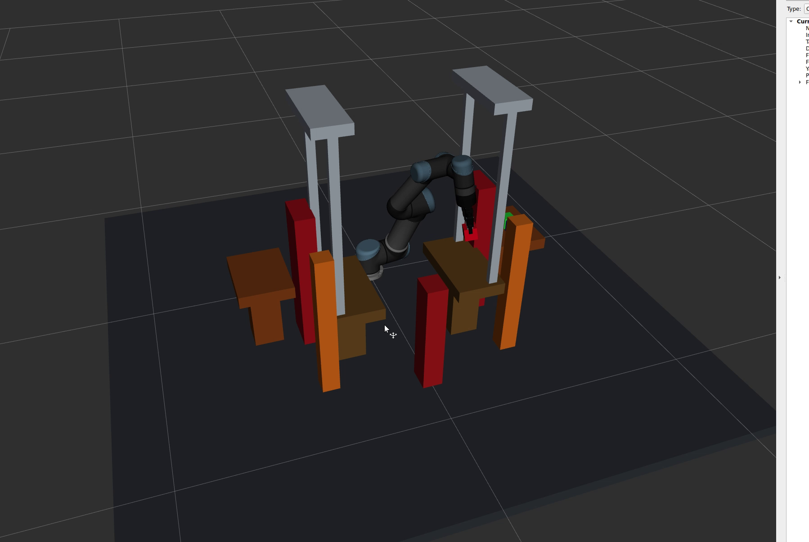

# Path Planning for Robotic Manipulators in a Cluttered Environment

ROS 2 Jazzy and MoveIt 2 simulation of a UR5 manipulator transferring a cube through a four-table workspace with blocking walls, gate pillars, and centered tabletop frames.



## Demonstrated task

The advanced demo moves `cube_1` through the cyclic route:

`Table 1 -> Table 2 -> Table 3 -> Table 4 -> Table 1`

The original three-cube scene is kept as a separately runnable baseline. The advanced scene adds four tables and static collision objects that intersect simple point-to-point routes. MoveIt/OMPL plans the inter-table travel around these obstacles.

## Main packages and files

- `ur5_three_cube_demo/src/scene_builder.cpp`: original three-cube scene.
- `ur5_three_cube_demo/src/three_cube_pick_place.cpp`: original pick-and-place task.
- `ur5_three_cube_demo/src/hard_scene_builder.cpp`: four tables, cubes, ground, blocking walls, gate pillars, and two centered tabletop frames.
- `ur5_three_cube_demo/src/four_table_cycle.cpp`: cyclic transfer controller and path-planning logic.
- `ur5_three_cube_demo/scripts/start_mock_gripper.sh`: starts the mock gripper controller when required.
- `moveit_ur5_interface/launch/moveit_ur5_interface_sim.launch`: simulation launch file used by the demo.

## Environment

- Ubuntu / WSL 2
- ROS 2 Jazzy
- MoveIt 2
- RViz 2
- UR5 with a Robotiq 2F-85 gripper model

## Build

```bash
cd ~/ur5_pick_place_ws
source /opt/ros/jazzy/setup.bash
colcon build --packages-select ur5_three_cube_demo --symlink-install
source install/setup.bash
```

## Run the advanced demonstration

Open the first WSL terminal and keep it running:

```bash
cd ~/ur5_pick_place_ws
source /opt/ros/jazzy/setup.bash
source install/setup.bash
ros2 launch moveit_ur5_interface moveit_ur5_interface_sim.launch
```

Open a second WSL terminal. Create the scene, wait until that command finishes, and then run the cycle:

```bash
cd ~/ur5_pick_place_ws
source /opt/ros/jazzy/setup.bash
source install/setup.bash

ros2 run ur5_three_cube_demo hard_scene_builder
ros2 run ur5_three_cube_demo four_table_cycle
```

Do not start a second simulation launch while the first one is still running. Duplicate `/move_group` or `/controller_manager` nodes can abort execution.

## Run the original baseline

With the same simulation launch running, use the second terminal:

```bash
ros2 run ur5_three_cube_demo scene_builder
ros2 run ur5_three_cube_demo three_cube_pick_place
```

## Planning design

The implementation separates contact motion from long-distance transfer:

1. Cartesian approach, descent, lift, lower, and retreat motions handle the local pick/place phases.
2. Inter-table travel uses inverse-kinematics candidates, nearby joint-solution selection, corridor waypoints, and MoveIt/OMPL planning.
3. Direct Cartesian-path tests are logged as diagnostics. In the cluttered scene they are often incomplete, while the same test without the blocking objects reaches 100%, demonstrating that the obstacles change the planning problem.

The Cartesian contact phases intentionally allow the expected gripper/cube/table contact. Therefore, the project should not be described as a fully collision-checked trajectory from start to finish.

## Demo video

[View the accelerated RViz demonstration](docs/demo/ur5-four-table-cycle-1.25x.mp4)

## Validation scope

The complete `Table 1 -> 2 -> 3 -> 4 -> 1` cycle was validated repeatedly in the ROS 2 mock simulation and finished with `FOUR-TABLE CYCLE: SUCCESS`. This repository demonstrates one-cube motion planning in simulation; it is not a real-hardware safety validation.

## Attribution

This project extends [JuoTungChen/ROS2_pick_and_place_UR5](https://github.com/JuoTungChen/ROS2_pick_and_place_UR5) with the preserved baseline demo and the new four-table cluttered-environment task.
